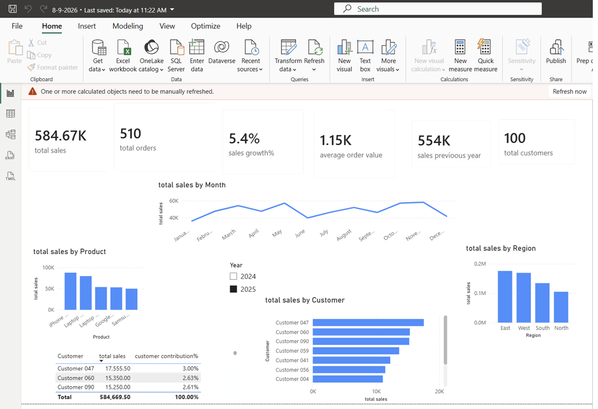

# Sales Dashboard with Power BI

## About
An interactive sales dashboard built in Power BI from an Excel dataset.
It tracks key sales KPIs and breaks sales down by month, product, region and customer.

## Dashboard Preview

## Key Metrics
- **Total sales:** 1.14M
- **Total orders:** 1K
- **Average order value:** 1.14K
- **Total customers:** 100
- **Sales growth:** 105.4% (previous year: 554K)

## Visuals
- Total sales by month (line chart)
- Total sales by product (column chart)
- Total sales by region (column chart)
- Total sales by customer (bar chart) and customer contribution %
- Year slicer (2024 / 2025)

## Skills Used
Power BI, DAX measures (sales growth %, customer contribution %),
data modeling, Excel as a data source, dashboard design

## Data Source
Public Excel dataset (not collected by the author).

## Possible Next Steps
- Investigate the sales dip in July
- Add a calendar table for time-intelligence calculations
- Build a second page for customer segmentation
